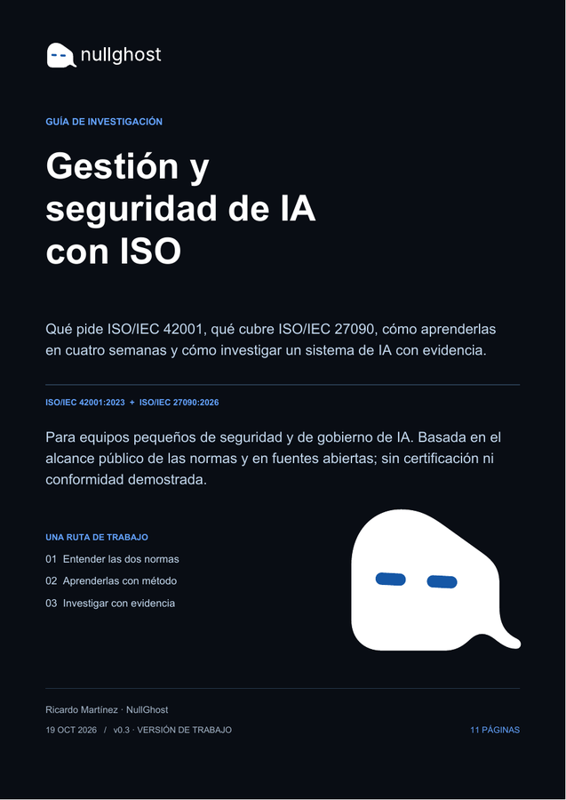

# Guía de investigación y manual de buenas prácticas de IA

**NullGhost · versión de trabajo v0.3 · 19 de octubre de 2026.**

Dos materiales prácticos para estudiar y documentar la gestión y seguridad de IA a partir del alcance público de ISO/IEC 42001:2023 e ISO/IEC 27090:2026. Se publican como guía y manual, con la identidad oficial de NullGhost. Son documentos distintos de la serie de papers académicos de la organización.

## Documentos

| Tipo | PDF (español) | Fuente editable |
|---|---|---|
| Guía de investigación, 11 páginas | [Gestión y seguridad de IA](guides/es/Guia_de_Investigacion_IA.pdf) | [Markdown](guides/es/Guia_de_Investigacion_IA.md) |
| Manual de buenas prácticas, 10 páginas | [Prácticas de IA](manuals/es/Manual_de_Buenas_Practicas_IA.pdf) | [Markdown](manuals/es/Manual_de_Buenas_Practicas_IA.md) |

[Ver en NullGhost](https://nullghost.io/ia-normas.html) · [Release v0.3](https://github.com/nullghost-io/ai-governance-evidence/releases/tag/v0.3)



## Video y publicación web

[Video español](video/iso-ai-es.mp4) · [English video](video/iso-ai-en.mp4). Dos versiones de 30 segundos con la marca oficial. Integrados en Inicio, Investigaciones y la página de las guías; referencias ISO en Servicios. Los videos muestran las portadas de la v0.2; los documentos vigentes son la v0.3.

## Research guide and good-practice manual

The Spanish PDFs explain what ISO/IEC 42001 requires and what ISO/IEC 27090 covers, propose a four-week learning path, and provide an evidence workflow and practical templates. ES/EN summaries are available on the website. These are working guides and manuals, not entries in NullGhost's academic paper series. Version 0.3 rewrites the content of version 0.2.

## Alcance y revisión pendiente

- Alcance público de las normas y fuentes secundarias marcadas [S] para su estructura (cláusulas y Anexo A de 42001; amenazas de 27090). No se han revisado íntegramente las normas ISO ni se redistribuyen. La fecha de publicación de 27090 no está reverificada.
- NIST AI 100-2e2025: índice leído (3.2 cadena de suministro, 3.4 inyección indirecta, 3.5 seguridad de agentes); OWASP Top 10 para LLM 2025 y MITRE ATLAS por cobertura de terceros. Las correspondencias entre amenazas y fuentes son propias y aproximadas.
- El camino de cuatro semanas, los estados de evidencia y las fichas son propuestas de NullGhost, sin validación con otros equipos ni resultados de eficacia.
- Ejemplos sintéticos; sin datos de clientes. Revisión técnica humana, contraste normativo y validación del protocolo pendientes.
- Elaboración asistida por IA; sin certificación o conformidad demostrada.

## Plantillas

[Inventario](templates/inventario.csv) · [Riesgos](templates/riesgos.csv) · [Pruebas](templates/pruebas.csv) · [Matriz de aplicación](templates/matriz_aplicacion.csv).

Contienen cabeceras, sin datos inventados. Las referencias de cláusula se completan solo después de verificarlas.

## Reconstruir

```sh
python3 -m venv .venv
. .venv/bin/activate
pip install -r requirements.txt
python3 build_pdf.py
```

Contenido canónico: `content.py`. El generador produce PDF y Markdown en `guides/es/` y `manuals/es/`. Inserta los SVG originales de `assets/brand/`, sin reconstruir el fantasma ni componer el logo con texto. Usa Arial instalada en macOS o Helvetica como alternativa portable; revisar el render al cambiar de entorno.

## Versiones y fuentes

[Historial](CHANGELOG.md) · [Fuentes](sources.json) · [Huellas](SHA256SUMS.txt).

La v0.1 y la v0.2 se conservan solo como historial; la vigente es la v0.3. Utilizar las rutas actuales.

## Licencias

Código original: MIT. Texto y gráficos originales: CC BY 4.0. Las marcas y logotipos de NullGhost, normas y materiales de terceros conservan sus derechos y quedan excluidos de esa licencia. Ver LICENSE y LICENSE-CONTENT.md.
