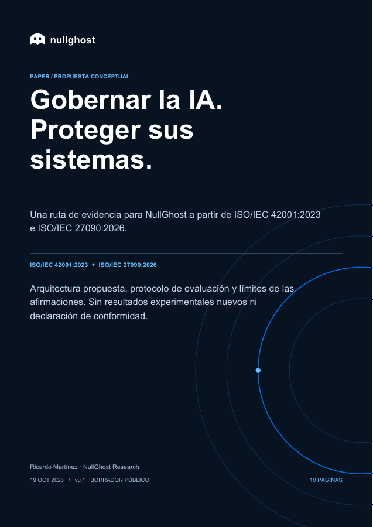

# Govern AI. Protect its systems. / Gobernar la IA. Proteger sus sistemas.

NullGhost Research · **public draft v0.1** · 19 October 2026.

A conceptual architecture and evidence protocol for AI-enabled security work, informed by the public scopes of ISO/IEC 42001:2023 and ISO/IEC 27090:2026. Includes a practical workbook. This is original analysis, not an ISO publication, conformity assessment or certification claim.

Una propuesta para conectar decisiones de gestión, protección técnica y evidencia revisable en NullGhost. El protocolo todavía no ha sido validado experimentalmente y no se ha completado la revisión de las normas íntegras.

## Documents / Documentos

| Documento | PDF | Fuente editable |
|---|---|---|
| Paper conceptual (ES, 10 páginas) | [Gobernar la IA. Proteger sus sistemas.](paper/es/Gobernar_y_Proteger_IA.pdf) | [Markdown](paper/es/Gobernar_y_Proteger_IA.md) |
| Guía práctica (ES, 9 páginas) | [De la intención a la evidencia.](paper/es/Guia_Practica_IA_ISO.pdf) | [Markdown](paper/es/Guia_Practica_IA_ISO.md) |

The PDFs are in Spanish; the website provides ES/EN summaries. All documents are drafts for human review, not experimentally validated findings.



## Scope and limits / Alcance y límites

- Public ISO catalog entries support identity, edition and general scope. Full standards were not reviewed or redistributed; no clause-level mapping is claimed.
- NIST AI 100-2e2025 was consulted selectively, including sections 3.4 and 3.5. The AI RMF page provides context, not a completed crosswalk.
- Architecture, evidence states, metrics and adoption stages are NullGhost proposals. No success rates or model comparisons were measured for this publication.
- Examples are synthetic. No client identifiers, reports, credentials or operational artifacts are included.
- AI-assisted drafting. Human technical review and empirical validation remain pending. Publication makes the draft available for review, not certified.

## Templates

[Inventory](templates/inventario.csv) · [Risks](templates/riesgos.csv) · [Tests](templates/pruebas.csv) · [Application matrix](templates/matriz_aplicacion.csv).

Templates contain headers only. Fill them for one authorized system; leave normative references pending until verified against the applicable edition.

## Rebuild

```sh
python3 -m venv .venv
. .venv/bin/activate
pip install -r requirements.txt
python3 build_pdf.py
```

`content.py` is the canonical editable content. `build_pdf.py` produces the PDFs and Markdown companions. On macOS it uses installed Arial; elsewhere PDF core Helvetica is the fallback. Font metrics may differ. Render and inspect every page after content or environment changes. No network access is required to build.

## Sources and versions

[Source ledger](sources.json) · [Changelog](CHANGELOG.md) · [Document hashes](SHA256SUMS.txt).

Official references: [42001](https://www.iso.org/standard/42001), [27090](https://www.iso.org/standard/27090), [NIST AI 100-2e2025](https://doi.org/10.6028/NIST.AI.100-2e2025), [NIST AI RMF](https://www.nist.gov/itl/ai-risk-management-framework).

## License

Original code: MIT, see LICENSE. Original document text and artwork: CC BY 4.0, see LICENSE-CONTENT.md. Third-party standards and materials retain their own rights. No endorsement by ISO or NIST is implied.
